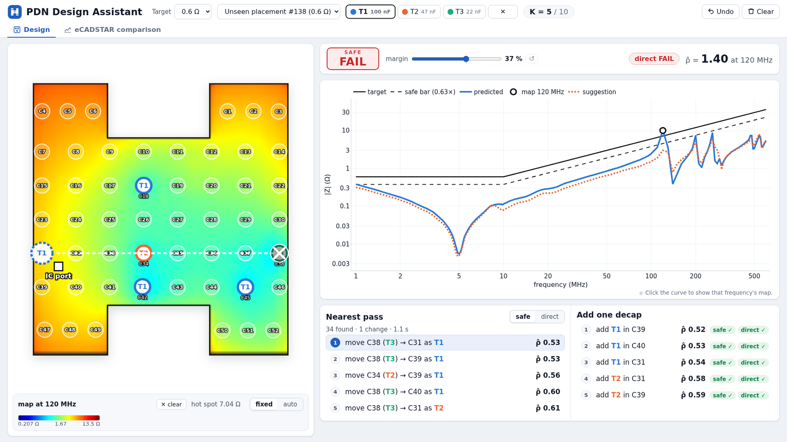
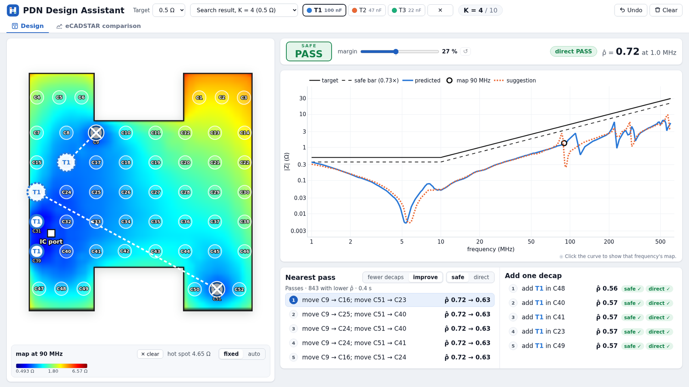
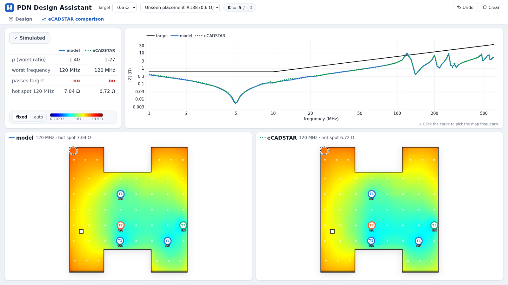
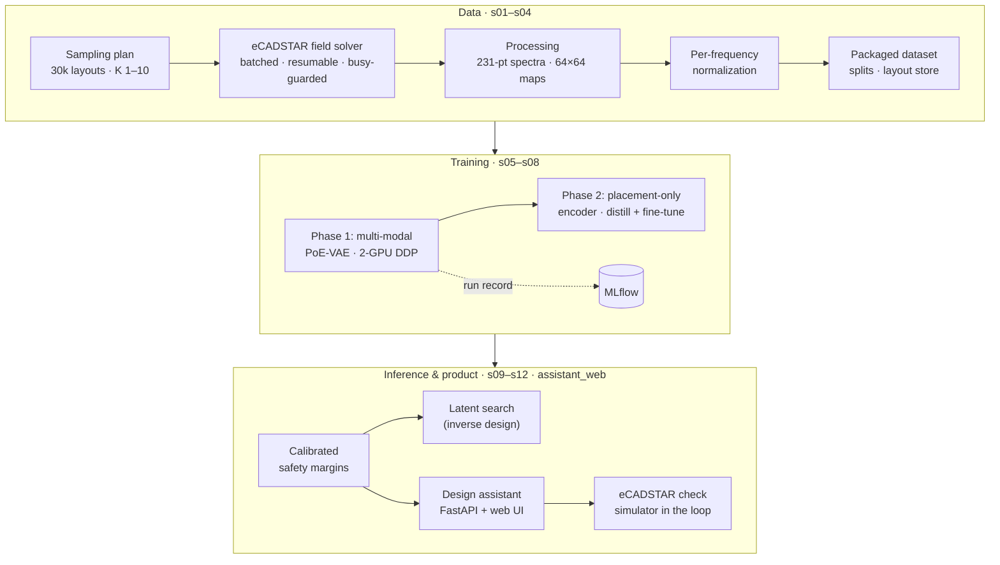
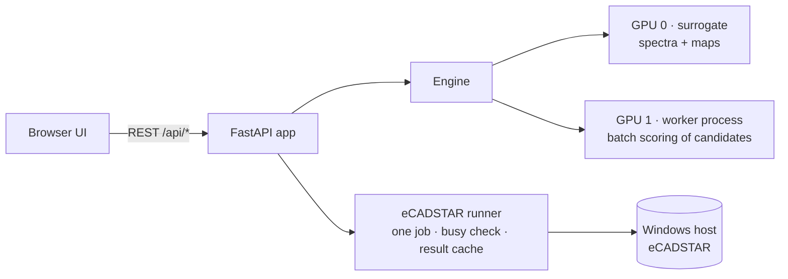

<div align="center">

# PDN Design Assistant

**A multi-modal generative surrogate for PCB power-delivery-network design — trained on 30,000 circuit simulations,
served as an interactive design tool with simulator-in-the-loop verification.**

[](https://github.com/kovarthanmuthusamy/pdn-genai-optimization/actions/workflows/ci.yml?query=branch%3Amain)




<sub>Master's thesis project · Kovarthanam Muthusamy · 2026</sub>

</div>

---

## The problem

Every chip on a printed circuit board needs a clean supply voltage. Engineers keep the supply's
impedance under a frequency-dependent **target** by placing **decoupling capacitors (decaps)** — but
which capacitor goes into which of the board's 52 slots has no closed-form answer. The usual loop is
*place → run a field solver → inspect the spectrum → move parts → simulate again*, with a solver run for
every candidate. The design space is combinatorial — over 600 million layouts with five decaps alone — so
the loop is slow and depends on experience.

## What I built

| | |
|---|---|
| **A generative surrogate of the board** | A product-of-experts **variational autoencoder** (10.2 M parameters) with graph encoders over the 52-slot board, a spectrum encoder and a CNN map decoder conditioned on frequency (FiLM). It learns placement ↔ impedance spectrum (231 points, 1–600 MHz) ↔ spatial impedance map (64 × 64). A second, placement-only encoder predicts both from the layout alone — the path available at design time. |
| **Inverse design** | With the decoder frozen, a guided search in the latent space proposes placements, with a part type per slot, that meet a target spectrum with as few decaps as possible. |
| **A design assistant** | Checks a layout against the target with a calibrated safety margin, and ranks the nearest passing layouts (type changes, moves, removals), cheaper layouts with fewer decaps, or improvements within the same budget. |
| **A web app with the simulator in the loop** | A FastAPI service and browser UI for the live demo: click slots, see the verdict, spectrum and map instantly, and send any layout to the field solver (eCADSTAR) to compare prediction and simulation side by side. |
| **The ML system around it** | A 13-stage, config-driven pipeline from sampling plan to evaluation, resumable simulation orchestration, multi-GPU training and inference, CI, Docker images, experiment tracking and three test suites. |

## Highlights

- **30,000 simulated layouts** (1–10 decaps, three part types, 330,000 maps) generated with a batched,
  resumable eCADSTAR pipeline — about 100 h of solver time *(thesis Sec. 3.1, 4.3.7)*.
- **2.9 % typical error** per frequency point of the predicted spectrum on the test layouts *(Sec. 4.2)*.
- **≈ 25,000 layouts per second** judged by the surrogate, against ≈ 12 s per layout in the field
  solver *(Sec. 4.3.4, 4.3.7)*.
- The inverse-design search reaches the **smallest feasible budgets** (3, 3 and 4 decaps for the three
  targets; for the hardest one as far as the simulated sample shows), confirmed by simulation in every run;
  **87–98 %** of all its proposals pass *(Sec. 4.3)*.

## Demo

<table>
<tr>
<td width="50%"></td>
<td width="50%"></td>
</tr>
<tr>
<td><b>Improve within the budget.</b> For a passing layout the assistant ranks same-budget changes by how much they lower the worst-case ratio; hovering previews the change on the board and in the plot.</td>
<td><b>Simulator in the loop.</b> One click simulates the layout in eCADSTAR (≈ 20 s, cached) and compares spectrum, verdict and hot spot with the model.</td>
</tr>
</table>

## Architecture

**End-to-end lifecycle** — every box is a stage of [`thesis_code/`](thesis_code/README.md) or the web app:



**Serving runtime** of the web app:



The fix search scores up to 400k candidate layouts per request. Candidates are split over both GPUs in
separate **processes** (threads gave only 1.2× because of the GIL); the split falls on the model's batch
boundaries, so results are bit-identical to a single GPU and a 3-change search takes ≈ 6 s instead of 13 s.

## Engineering & MLOps

| Area | What is in place |
|---|---|
| **Reproducibility** | Every stage is a module with one `CONFIGURATION` block and thesis defaults; seeded sampling and splits; run records with git commit, versions, device and a config fingerprint; pinned environment in `requirements.txt`. |
| **Data pipeline** | Simulation campaigns in resumable batches with a progress file; a result store so a layout is never simulated twice; a guard that refuses to start while another job uses the shared solver host; a batch-ordering rule that avoids a solver defect affecting slot C1. |
| **Training** | Two-phase training (VAE, then the placement-only encoder) with PyTorch DDP on two GPUs, curriculum schedule, per-epoch metric files and checkpoints with their configuration. |
| **Experiment tracking** | [`tools/mlflow_log_run.py`](tools/mlflow_log_run.py) logs a finished run (83 parameters, 55 metric series, plots, checkpoint hash) to MLflow; idempotent, SQLite backend. |
| **Testing** | `tests/ci` — 116 data-free tests (imports, model on CPU, assistant logic against the thesis code, REST API, tracking); `tests/thesis_code` — equivalence of the packaged pipeline with the research code; `tests/assistant_web` — the web app against the thesis assistant on the trained weights (GPU). |
| **CI** | GitHub Actions: Ruff, the data-free suite on CPU PyTorch with JUnit report, and Docker builds that run the suite inside the image. |
| **Packaging & serving** | Multi-stage `Dockerfile` (`serve` / `train` / `test`, CUDA or CPU wheels via a build argument), non-root user, health check; `docker-compose.yml` with GPU reservation; weights and data mounted at run time, never baked in. |
| **API** | FastAPI with typed request models and OpenAPI docs at `/docs`; batch prediction endpoint for programmatic use. |

## Tech stack

| Area | Tools |
|---|---|
| **ML** | PyTorch 2.7 · graph networks · VAE / product of experts · FiLM conditioning · DDP (multi-GPU training) |
| **Serving** | FastAPI · Uvicorn · Pydantic · Plotly.js · vanilla JS/SVG |
| **MLOps** | Docker (multi-stage) · Docker Compose · GitHub Actions · MLflow · pytest · Ruff · Make |
| **Data & plots** | NumPy · SciPy · pandas · matplotlib |
| **Simulation** | eCADSTAR (Zuken) PI solver, driven headless from WSL |
| **Research code** | scikit-learn (Gaussian-process error model for active learning) · seaborn · tqdm · PyYAML — earlier experiments only, not needed by `thesis_code/` |
| **Docs** | LaTeX (thesis) · Obsidian knowledge graph generated from the code ([`tools/build_vault.py`](tools/build_vault.py)) · Mermaid diagrams |
| **Dev workflow** | Claude Code (custom evidence-extraction and fact-review agents) · Cursor |
| **Hardware** | 2× NVIDIA Quadro GV100 (CUDA 11.8) · WSL2 on Windows, next to the solver host |

## Repository layout

```
thesis_code/        the final pipeline, by stage: s01 generation … s05 model … s07 training … s11 assistant, s12 evaluation
assistant_web/      design-assistant web app: engine (multi-GPU), FastAPI server, eCADSTAR runner, static UI
tests/
  ci/               data-free suite (CPU, runs in CI)
  thesis_code/      equivalence tests of the packaged pipeline (needs the dataset)
  assistant_web/    web app vs. thesis assistant (needs the weights + GPU)
tools/              mlflow_log_run.py and repository tools
docs/               design specs, images
legacy/             the first MLOps stack (earlier exp059 model), kept for reference
experiments/, pipelines/, active_learning_pi/   research history: earlier model generations and studies
Thesis_report/      the thesis (LaTeX)
```

## Quick start

```bash
git clone git@github.com:kovarthanmuthusamy/pdn-genai-optimization.git && cd pdn-genai-optimization
python3.10 -m venv .venv && source .venv/bin/activate
pip install torch==2.7.1 --index-url https://download.pytorch.org/whl/cu118   # CPU only: .../whl/cpu
make install        # pinned runtime + dev + tracking extras
make test           # data-free suite, CPU, ~20 s
```

The trained weights (≈ 145 MB: `last_model.pt`, `occ_to_z_distill.pt`, `vae_route_finetune/H1_spec_hm200*`)
and the dataset are not part of the repository. With the weights in
`experiments/exp096_k1k10_balanced30k_ep700/checkpoints/`:

```bash
make serve                                  # web app on http://localhost:8050 (uses up to 2 GPUs, falls back to CPU)
docker compose up --build                   # the same in a container with GPU access
make test-full                              # all three suites (dataset + weights + GPU)
make mlflow                                 # log the training run and open the MLflow UI
```

Each pipeline stage runs as a module, e.g. `python -m thesis_code.s07_training.train` (2 GPUs:
`torchrun --standalone --nproc_per_node=2 -m thesis_code.s07_training.train`); paths to data, weights
and the solver live in [`thesis_code/common/settings.py`](thesis_code/common/settings.py).

## REST API

| Endpoint | Purpose |
|---|---|
| `POST /api/predict` | batch spectra for up to 4,096 layouts; with a target also worst-case ratios and verdicts |
| `POST /api/check` | verdict of one layout (safe with a calibrated margin, and direct), spectrum, best one-decap additions |
| `POST /api/map` | predicted impedance map at one of the 231 frequencies, with its hot spot |
| `POST /api/fixes` | nearest passing layouts — or fewer-decap layouts for a passing one |
| `POST /api/improve` | same-budget changes that lower the worst-case ratio the most |
| `POST /api/ecad/run` · `GET /api/ecad/status` · `POST /api/ecad/result` | simulate a layout in eCADSTAR and compare (409 while the solver is busy) |
| `GET /docs` | interactive OpenAPI documentation |

```bash
curl -s localhost:8050/api/predict -H 'Content-Type: application/json' \
  -d '{"placements": [[1,0,0,0,0,0,0,0,0,0,0,0,0,0,0,0,0,0,0,0,0,0,0,0,0,0,0,0,0,0,1,0,0,0,0,0,0,0,1,0,0,0,0,0,0,0,0,0,0,0,0,0]], "target": "0.8"}'
```

## Research history

The model is the last of a series of experiments — from a single-type surrogate with a fixed frequency grid,
through multi-type layouts and random-frequency training data, to the balanced 30,000-layout dataset and the
700-epoch model packaged in `thesis_code/`. Earlier generations live in `experiments/`, `pipelines/` and
`active_learning_pi/` (an active-learning loop that was explored and then dropped in favour of the
inverse-design path); the first MLOps stack is in [`legacy/exp059_mlops/`](legacy/exp059_mlops/README.md).

## Thesis

*A Generative AI Framework for the Design Optimization and Performance Analysis of PCB Power Delivery
Networks* — Kovarthanam Muthusamy, 2026. The LaTeX sources are in [`Thesis_report/`](Thesis_report/);
Appendix D maps every file of `thesis_code/` to the section it implements.

## License

All rights reserved — this repository is shown for portfolio and thesis review.
